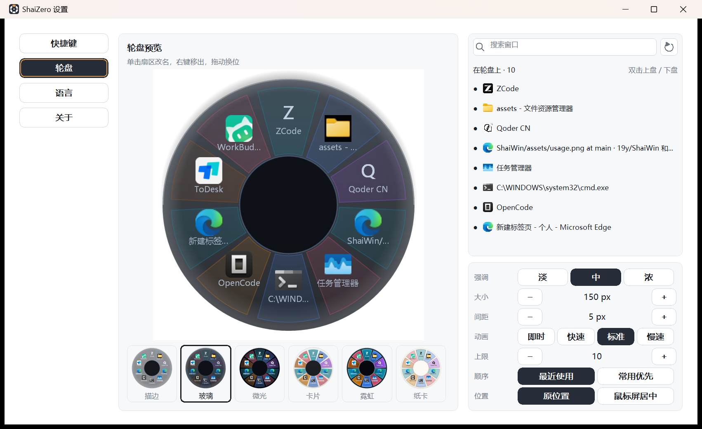

# ShaiZero

**按住 `Alt` 在桌面任意位置按下鼠标左键呼出窗口轮盘选择打开需要的窗口**

一个 Windows 窗口切换器：单 exe、绿色免安装、不需要管理员权限。



---

## 快速上手

1. 运行 `ShaiZero.exe`，托盘出现图标。
2. 按住 `Alt`，在桌面或任意窗口里按住左键呼出轮盘。
3. 指针停在某一格松手：那个窗口到前台。拖回圆心松手或按 `鼠标点击右键`：取消。
4. `Ctrl+2`：把当前窗口放上轮盘。
5. `Ctrl+T`：打开设置。

`Ctrl+2` 或双击上盘的窗口不受上限限制。

---

## 下载

到 [Releases](https://github.com/19y/ShaiZero/releases/latest) 下载最新的 `shaizero-<版本>-win64.zip`，解压到任意目录，双击 `ShaiZero.exe` 就能用。

- 单个 exe，绿色免安装，不需要 .NET / VC++ 运行库，不需要管理员权限。
- 压缩包里只有 `ShaiZero.exe`、`LICENSE`、`README.md` 三个文件；卸载 = 删掉目录 + 删掉 `%LOCALAPPDATA%\ShaiZero\`。
- 每个 release 都附带 `SHA256SUMS.txt`，想校验下载完整性：

  ```powershell
  certutil -hashfile shaizero-<版本>-win64.zip SHA256
  ```

**运行要求**：Windows 10 1809+ 或 Windows 11，x64。

> 维护者：`git tag v0.1.0 && git push origin v0.1.0` 就会触发 GitHub Actions，自动跑测试、构建、打包并创建对应的 release（见 `.github/workflows/release.yml`）；本地出同款包用 `scripts\package.ps1`。

---

## 设置

左栏四页，改哪一行当场生效，没有保存/取消：

| 页 | 内容 |
| --- | --- |
| 快捷键 | 触发组合键（点方框后按想用的键或鼠标键）、上盘快捷键（默认 `Ctrl+2`）、打开设置（默认 `Ctrl+T`） |
| 轮盘 | 实时预览 + 主题/强调/大小/间距/动画/上限/选取顺序/位置 + 窗口列表 |
| 语言 | 跟随系统或指定语言，打开语言文件夹 |
| 关于 | 版本、日志、减弱动态效果、许可证 |

轮盘页的预览可以直接操作：单击扇区改名，右键只有一个「移出轮盘」，拖动换位，拖预览外侧留白处调整整体角度。**轮盘呼出后角度固定**，只能在设置预览里改，手势拖到轮盘外圈不会误改角度。右侧窗口列表分「在轮盘上 / 未上轮盘」两组，双击上盘或下盘；下盘只留空位置，别的窗口不会补进来。

设置文件在 `%LOCALAPPDATA%\ShaiZero\settings.txt`，日志在同目录 `shaizero.log`。手改文件前先退出程序，否则下一次落盘会覆盖。

主要键：

| 键 | 含义 | 默认 |
| --- | --- | --- |
| `trigger_mods` / `trigger_key` / `trigger_button` | 触发键（`trigger_key=0` 用鼠标键） | `Alt` + 左键 |
| `drag_threshold` | 拖出多少像素算手势（2–40） | `8` |
| `wheel_radius` / `wheel_seam` / `wheel_open_ms` | 半径、扇区间距、展开动画 | `150` / `5` / `180` |
| `wheel_rotate` | 整体旋转角度（度，只能在设置预览里拖出来） | `0` |
| `wheel_limit` | 启动时默认坐多少格（3–24） | `10` |
| `dial_order` / `activate_pos` | 选取顺序；切过去时留在原位或居中到鼠标屏 | `0` / `0` |
| `seat_order` | 记住的座位顺序（指纹） | 空 |
| `bound_seats` / `parked_seats` | 手工上盘 / 下盘但保留座位 | 空 |
| `seat_hwnds` | 点名到窗口句柄的座位（只对本次运行有效） | 空 |
| `off_dial` | 按句柄移出的窗口 | 空 |
| `window_tags` | 标签，`指纹=文字` | 空 |
| `fav_mods` / `fav_vk` | 上盘快捷键 | `Ctrl+2` |
| `panel_mods` / `panel_vk` | 打开设置页 | `Ctrl+T` |
| `lang` / `reduced_motion` | 语言；减弱动画 | `auto` / `0` |

指纹是 `exe 路径|窗口类|标题第一个词`。认不出的行会被丢掉，越界的数字会被夹回区间。旧目录（`SpinWin`、`ShaiWin`、`PanWen`）里的设置和语言包会在启动时自动搬进来。

---

## 构建与测试

需要 Windows 10 1809+ / 11 x64、Rust stable（edition 2021）、MSVC 或 MinGW-w64。

```powershell
cargo build -p shaiwin --release     # -> target\release\ShaiZero.exe
cargo run -p shaiwin                 # 开发构建
cargo test --workspace               # 140 个单元测试（app 83 + core 45 + platform 12）
```

打 tag 推送会触发 `.github/workflows/release.yml` 自动测试、构建、打包并建 release。本地打包用 `scripts\package.ps1`。

端到端脚本（跑真实钩子和夹具窗口，不动你自己的窗口）：

```powershell
powershell -NoProfile -ExecutionPolicy Bypass -File scripts\hook-test.ps1
powershell -NoProfile -ExecutionPolicy Bypass -File scripts\edge-test.ps1
powershell -NoProfile -ExecutionPolicy Bypass -File scripts\settings-shot.ps1
powershell -NoProfile -ExecutionPolicy Bypass -File scripts\lang-import-test.ps1
powershell -NoProfile -ExecutionPolicy Bypass -File scripts\wheel-test.ps1
```

`scripts\testkit.ps1` 是它们共用的 Win32 声明、夹具窗口和独立 `LOCALAPPDATA`。`wheel-test.ps1` / `edge-test.ps1` 的部分断言还停在已删除的旧功能上，不能当完整回归网。

---

## 项目结构

```
crates/core/           纯 Rust：轮盘几何与排位、手势状态机、配色、命中测试
crates/platform-win/   Win32：鼠标钩子、窗口枚举与 z 序、任务栏进出、多屏 DPI
crates/app/            外壳：托盘、快捷键、轮盘绘制、设置窗口、标签框、i18n、日志
languages/ru.txt       一份完整俄语包
scripts/               端到端脚本、打包、图标工具
```

分层原则：`core` 不知道 Windows 存在，`platform-win` 不知道 UI 存在，`app` 只做编排。

---

## 许可

**MIT License + Commons Clause**：可免费使用、修改、闭源分发、企业内部部署；**不得有偿销售本软件或其衍生服务**。完整条款见 [LICENSE](LICENSE)。

---

## 请我喝杯咖啡

如果 ShaiZero 帮你少找了几次窗口，可以请我喝杯咖啡。


